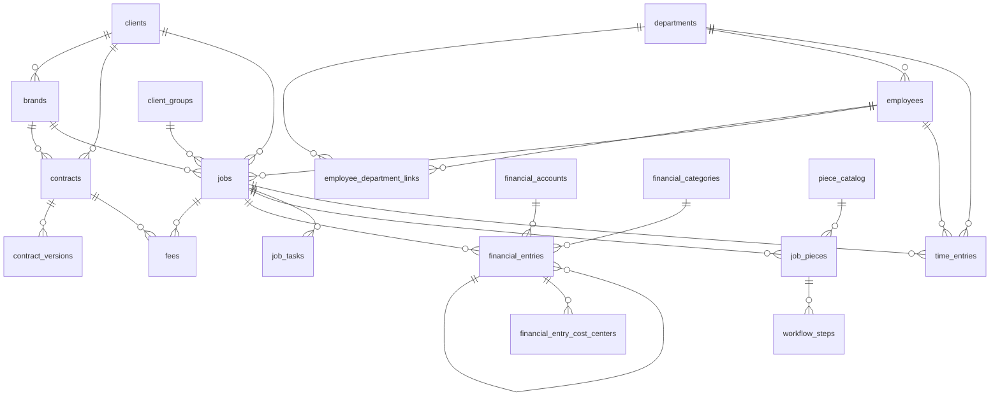

# Modelagem PostgreSQL — `quest_rinne`

Um banco, quatro schemas, nenhuma outra persistência. Migrations em `server/db/migrations`; colunas, constraints, índices e privilégios em [DICIONARIO_BANCO.md](DICIONARIO_BANCO.md).

| schema | conteúdo | quem grava |
|---|---|---|
| `app` | usuários, perfis, sessões, auditoria, configurações, controle de acesso | a aplicação (`qi_app`) |
| `core` | dados comerciais, financeiros, operacionais e gerenciais | a integração (`qi_ingest`) |
| `ingest` | origens, tarefas, páginas, checkpoints e erros de coleta | a integração |
| `audit` | estado de publicação e conflitos | a integração |

## Roles (privilégio mínimo)

| role | login | pode | não pode |
|---|---|---|---|
| `qi_owner` | não | dona dos objetos | conectar |
| `qi_migrator` | sim, só no deploy | assumir `qi_owner` e aplicar migrations | ficar no ambiente da API |
| `qi_app` | sim | ler e gravar `app` (auditoria sem UPDATE) | ler `core`, criar objetos |
| `qi_reader` | sim | SELECT em `core`, `ingest`, `audit` (sessão somente leitura) | gravar; ler `app` |
| `qi_ingest` | **não** até a coleta ser homologada | inserir e atualizar `core`, `ingest`, `audit` | acessar `app`; alterar metas, regras e origens |

Nenhuma é superusuário. `CONNECT` é revogado de `PUBLIC`: credenciais antigas não conectam. `postgres` só é usado dentro do container do banco, pelo instalador, para criar as roles.

## Decisões

- **Mesmos nomes das consultas existentes** (`core.jobs`, `core.time_entries`, `iclips_id`…): indicadores, gráficos e regras de cálculo foram reaproveitados sem reescrita. `schema-empty.test.ts` prova que todos funcionam sobre o banco vazio.
- **Rastreio em toda linha integrada:** `source_system`, `ingest_task_id` (obrigatório), `source_updated_at`, `record_hash`, `created_at`, `updated_at`. Um workflow antigo que tente gravar falha, porque não informa a tarefa.
- **Idempotência pela chave de origem:** `iclips_id` (ou `id` em apontamentos e departamentos) é a chave primária das entidades principais; entidades novas usam `(source_system, external_id)`.
- **Chaves estrangeiras adiáveis:** pai e filho podem ser gravados na mesma transação; referência inexistente no `COMMIT` é rejeitada.
- **`core.departments.id` é texto** e referenciado por apontamentos e colaboradores, como as consultas esperam.
- **`app.users.scope_department` não tem FK:** o cadastro de departamentos vem da integração e a aplicação não escreve em `core`.
- **Metas e regras de rateio** são cadastro gerencial aprovado: uma regra só fica ativa com `approved_at`. Nenhum valor é pré-carregado.
- **Uma origem principal:** `iclips_id` supõe um único sistema para as entidades principais. Uma segunda origem para a mesma entidade exigirá nova migration.

## Relacionamentos de `core`

<!-- er:inicio -->

<!-- er:fim -->

## Migrations

`npm run db:migrate` (com `MIGRATION_DATABASE_URL`) aplica o que falta, uma transação por arquivo, com trava global. Arquivo já aplicado é imutável (conferido por SHA-256): mudanças entram em um novo `NNN_nome.sql`. O instalador e o atualizador executam as migrations antes de subir a API, e a API se recusa a iniciar com migration pendente. Não há migration de volta: uma mudança precisa ser compatível com a imagem anterior para o rollback funcionar.
